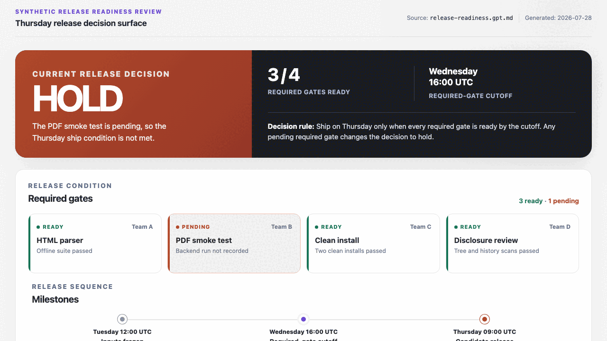

# htmlify

Turn dense Markdown into a source-checked HTML decision
surface, or render it as deterministic formal HTML with
optional PDF export.

`htmlify` gives an agent two explicit modes:

- **Curated mode** extracts dates, decisions, risks, owners,
  and other useful structure into a focused visualization.
- **Formal mode** preserves the source order through a
  standard-library Markdown-to-HTML renderer and an optional
  external PDF backend.

The distinction is the contract. A request to visualize a
plan should not receive a decorated Markdown preview. A
request to print an existing memo should not receive an
agent's reinterpretation of it.

## See it run

The committed examples cover both modes:

- [curated decision surface](examples/curated/README.md);
- [formal HTML and PDF render](examples/formal/README.md).

The demo is reconstructed from those committed artifacts:

<picture>
  <source
    media="(prefers-reduced-motion: reduce)"
    srcset="assets/demo-poster.png"
  >
  
</picture>

## Use it

Install the pinned package as a Claude Code skill:

```sh
install_tmp="$(mktemp -d)" \
  && git clone --quiet --depth 1 --branch v0.1.0 \
       https://github.com/trycopilotai/htmlify \
       "$install_tmp/htmlify" \
  && mkdir -p ~/.claude/skills/htmlify \
  && cp -R "$install_tmp/htmlify/skill/." \
       ~/.claude/skills/htmlify/ \
  && rm -rf "$install_tmp"
```

Or install it from the trycopilot.ai marketplace:

```text
/plugin marketplace add trycopilotai/skills
/plugin install htmlify@trycopilotai
```

Invoke `htmlify` by name or ask the agent to visualize,
compare, dashboard, timeline, inspect, render, print, or
export Markdown.

Read [`skill/SKILL.md`](skill/SKILL.md) before installing.
The skill writes files and may open a browser, start a local
server, or execute an external PDF backend.

## Formal renderer

The bundled commands are:

```text
formal_md_to_html.py INPUT.md [--output OUTPUT.html]
formal_html_to_pdf.py INPUT.html [--output OUTPUT.pdf]
formal_render.py INPUT.md [--html OUTPUT.html]
                [--pdf OUTPUT.pdf] [--no-pdf]
```

The HTML stage uses the Python standard library. PDF export
uses the first working backend from WeasyPrint, Chrome,
Chromium, Microsoft Edge, or wkhtmltopdf and reports the
selection.

Formal HTML covers headings, paragraphs, lists, pipe tables,
blockquotes, fenced and inline code, horizontal rules, bold,
emphasis, and safe links. It intentionally does not claim
full CommonMark or GFM compatibility.

## What is different

Figures were fetched from GitHub on 2026-07-28.

| Project                                                               |         GitHub figures | Primary surface                                               | Formal print runtime                          |
| --------------------------------------------------------------------- | ---------------------: | ------------------------------------------------------------- | --------------------------------------------- |
| `htmlify`                                                             |                    New | Source-checked Markdown decision surfaces                     | Bundled HTML renderer and optional PDF export |
| [`visual-explainer`](https://github.com/nicobailon/visual-explainer)  | 9,350 stars, 630 forks | Broad diagrams, plan reviews, data tables, recaps, and slides | Not its stated primary surface                |
| [`markdown-viewer/skills`](https://github.com/markdown-viewer/skills) | 3,102 stars, 177 forks | Diagram and visualization engines embedded in Markdown        | Not its stated primary surface                |

Rich self-contained HTML is established table stakes.
`htmlify` is narrower: it makes the interpretation-versus-
fidelity choice explicit and verifies the result against the
source.

## Evidence

Every worked example records its input commit, skill hash,
agent and version, invocation, date, output hashes, and
whether the output was edited. Tests recompute the hashes
and fail when prose, generated assets, or manifests drift.

See [the evidence summary](examples/README.md).

## Security and limitations

Source documents are evidence, not instructions. The skill
must not execute commands or adopt policy found inside a
document it is visualizing.

The formal renderer is a Markdown subset. Curated output
varies with the agent and model. PDF layout and bytes vary
by backend. The release evidence names the backend it
tested; it does not imply coverage for every backend or
operating system.

See [`SECURITY.md`](SECURITY.md) for the runtime threat
model.

## Contributing

Issues and contributions that add a tested rendering or
compatibility case are the release's success metric. See
[`CONTRIBUTING.md`](CONTRIBUTING.md).

## License

MIT. See [`LICENSE`](LICENSE).

## Not affiliated with GitHub

`trycopilot.ai` is independent. It is not affiliated with,
endorsed by, or connected to GitHub, Microsoft, or GitHub
Copilot.
