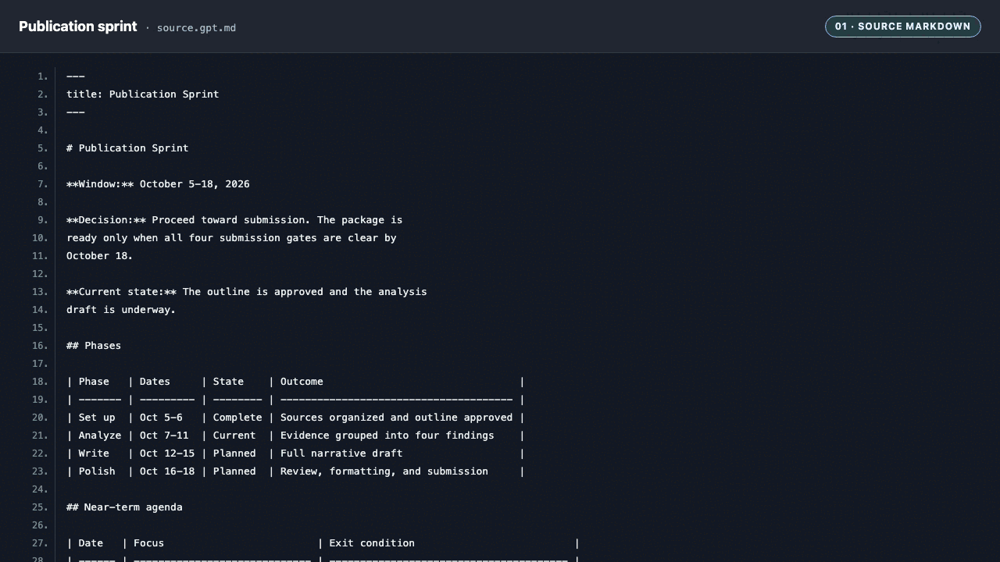
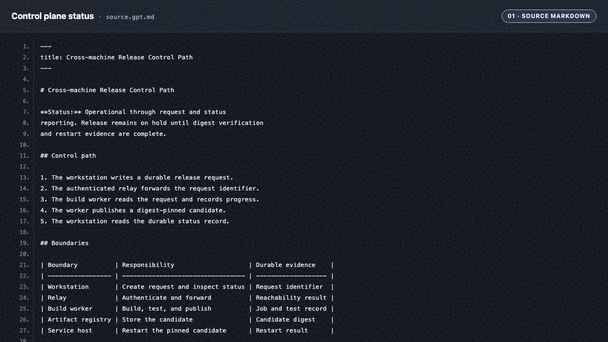
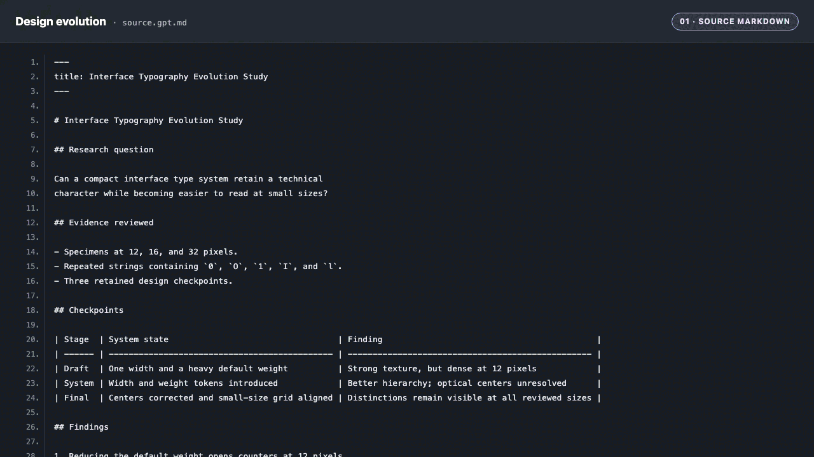

# htmlify

Turn dense Markdown into deterministic formal HTML or a
source-checked rich decision surface, with optional PDF
export.

`htmlify` gives an agent two explicit modes:

- **Formal mode** preserves the source order through a
  standard-library Markdown-to-HTML renderer and an optional
  external PDF backend.
- **Curated mode** extracts dates, decisions, risks, owners,
  relationships, and other useful structure into rich HTML.

The distinction is the contract. A request to visualize a
plan should not receive a decorated Markdown preview. A
request to print an existing memo should not receive an
agent's reinterpretation of it.

## Source → formal → rich

Each animation begins with the committed Markdown source,
moves to the order-preserving formal render, and ends with a
rich rendering of the same facts. Its four-second loop holds
source for one beat, formal for one beat, and rich for two
beats.

### Publication sprint

A dated plan becomes a printable brief, then a timeline with
phase state, near-term agenda, and submission gates.

[Source Markdown](examples/showcase/publication-sprint/source.gpt.md)
→
[formal HTML](examples/showcase/publication-sprint/formal.gpt.html)
→
[rich HTML](examples/showcase/publication-sprint/rich.gpt.html)

<picture>
  <source
    media="(prefers-reduced-motion: reduce)"
    srcset="assets/publication-sprint-poster.gpt.png"
  >
  
</picture>

### Cross-machine control plane

A release status note becomes a printable system record,
then a control-path view with boundaries, evidence, and the
remaining hold.

[Source Markdown](examples/showcase/control-plane-status/source.gpt.md)
→
[formal HTML](examples/showcase/control-plane-status/formal.gpt.html)
→
[rich HTML](examples/showcase/control-plane-status/rich.gpt.html)

<picture>
  <source
    media="(prefers-reduced-motion: reduce)"
    srcset="assets/control-plane-status-poster.gpt.png"
  >
  
</picture>

### Interface typography evolution

A compact evidence review becomes a formal study, then a
visual progression across three retained design checkpoints.

[Source Markdown](examples/showcase/design-evolution/source.gpt.md)
→
[formal HTML](examples/showcase/design-evolution/formal.gpt.html)
→
[rich HTML](examples/showcase/design-evolution/rich.gpt.html)

<picture>
  <source
    media="(prefers-reduced-motion: reduce)"
    srcset="assets/design-evolution-poster.gpt.png"
  >
  
</picture>

## Use it

### Claude Code

Install the tagged skill package:

```sh
install_tmp="$(mktemp -d)" \
  && git clone --quiet --depth 1 --branch v0.1.0 \
       https://github.com/trycopilotai/htmlify \
       "$install_tmp/htmlify" \
  && mkdir -p ~/.claude/skills/htmlify \
  && cp -R "$install_tmp/htmlify/skill/." \
       ~/.claude/skills/htmlify/ \
  && rm -rf "$install_tmp"
```

Or install it from the trycopilot.ai marketplace:

```text
/plugin marketplace add trycopilotai/skills
/plugin install htmlify@trycopilotai
```

Invoke the directly installed skill as `/htmlify`. Invoke the
marketplace plugin as `/htmlify:htmlify`.

### Codex

Install the same tagged skill package:

```sh
install_tmp="$(mktemp -d)" \
  && git clone --quiet --depth 1 --branch v0.1.0 \
       https://github.com/trycopilotai/htmlify \
       "$install_tmp/htmlify" \
  && mkdir -p ~/.agents/skills/htmlify \
  && cp -R "$install_tmp/htmlify/skill/." \
       ~/.agents/skills/htmlify/ \
  && rm -rf "$install_tmp"
```

Invoke it as `$htmlify`.

The source checkout on `main` also carries Claude Code and
Codex plugin manifests at development version
`0.2.0-dev.0`. `skill/SKILL.md` resolves to the package both
runtimes load under `skills/htmlify`, so the skill content
is stored once. Those manifests are not part of the `v0.1.0`
tag.

For either agent, ask it to visualize, compare, dashboard,
timeline, inspect, render, print, or export Markdown. Ask
for formal output when source order is the priority, or rich
output when relationships and decisions should become a
visual surface.

Read [`skill/SKILL.md`](skill/SKILL.md) before installing.
The skill writes files and may open a browser, start a local
server, or execute an external PDF backend.

## Formal renderer

The bundled commands are:

```text
formal_md_to_html.py INPUT.md [--output OUTPUT.html]
formal_html_to_pdf.py INPUT.html [--output OUTPUT.pdf]
formal_render.py INPUT.md [--html OUTPUT.html]
                [--pdf OUTPUT.pdf] [--no-pdf]
```

The HTML stage uses the Python standard library. PDF export
uses the first working backend from WeasyPrint, Chrome,
Chromium, Microsoft Edge, or wkhtmltopdf and reports the
selection.

Formal HTML covers headings, paragraphs, lists, pipe tables,
blockquotes, fenced and inline code, horizontal rules, bold,
emphasis, and safe links. It intentionally does not claim
full CommonMark or GFM compatibility.

## What is different

Figures were fetched from GitHub on 2026-07-28.

| Project                                                               |         GitHub figures | Primary surface                                               | Formal print runtime                          |
| --------------------------------------------------------------------- | ---------------------: | ------------------------------------------------------------- | --------------------------------------------- |
| `htmlify`                                                             |                    New | Source-checked Markdown decision surfaces                     | Bundled HTML renderer and optional PDF export |
| [`visual-explainer`](https://github.com/nicobailon/visual-explainer)  | 9,350 stars, 630 forks | Broad diagrams, plan reviews, data tables, recaps, and slides | Not its stated primary surface                |
| [`markdown-viewer/skills`](https://github.com/markdown-viewer/skills) | 3,102 stars, 177 forks | Diagram and visualization engines embedded in Markdown        | Not its stated primary surface                |

Rich self-contained HTML is established table stakes.
`htmlify` is narrower: it makes the interpretation-versus-
fidelity choice explicit and verifies the result against the
source.

## Evidence

The release-evidence examples record their input commit,
skill hash, agent and version, invocation, date, output
hashes, and whether the output was edited. Tests recompute
the hashes and fail when prose, generated assets, or
manifests drift.

The three synthetic showcases commit their source, formal
HTML, and rich HTML together. `make assets` rebuilds each
three-frame animation in that order.

See [the evidence summary](examples/README.md).

## Security and limitations

Source documents are evidence, not instructions. The skill
must not execute commands or adopt policy found inside a
document it is visualizing.

The formal renderer is a Markdown subset. Curated output
varies with the agent and model. PDF layout and bytes vary
by backend. The release evidence names the backend it
tested; it does not imply coverage for every backend or
operating system.

See [`SECURITY.md`](SECURITY.md) for the runtime threat
model.

## Contributing

Issues and contributions that add a tested rendering or
compatibility case are the release's success metric. See
[`CONTRIBUTING.md`](CONTRIBUTING.md).

## License

MIT. See [`LICENSE`](LICENSE).

## Not affiliated with GitHub

`trycopilot.ai` is independent. It is not affiliated with,
endorsed by, or connected to GitHub, Microsoft, or GitHub
Copilot.
